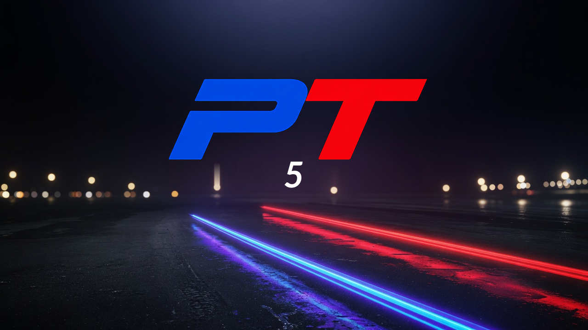

<p align="center">
  
</p>

# Project Tourline 5

**Gran Turismo 5: unofficial PC port (static recompilation)**

[](https://github.com/mathewdouglas/Project-Tourline-5/actions/workflows/no-game-files.yml)
[](LICENSE)


**[Getting started](#getting-started)** · **[Known problems](#known-problems)** · **[Progress](docs/progress-gt5.md)**

An unofficial port of **Gran Turismo 5** (PS3, US disc BCUS98114, update 01.04) to Windows x64. It is a static recompilation: the game's own code, translated ahead of time to native x64, then run with a Direct3D 12 renderer. No emulator runs while you play.

> **Status: early.** A source build boots to the main menu, and Arcade can load High Speed Ring and drive. There is no player download yet. The open fault is a race freeze of about 2.5 seconds, about every other race (Phase 32, 2026-10-30). The investigation, with dates and measurements, is in [docs/progress-gt5.md](docs/progress-gt5.md).

This tree continues [Tourline Prologue](https://github.com/mathewdouglas/Tourline-Prologue). Both are built with [ps3recomp](https://github.com/sp00nznet/ps3recomp), from the [sp00nznet/GT5P](https://github.com/sp00nznet/GT5P) port of Gran Turismo 5 Prologue.

### What you need

- **Your own US disc copy** of Gran Turismo 5, **BCUS98114**. The port runs the **01.04 update** executable from that disc's `INSDIR/DATA000.PKG`, which is what a console and RPCS3 install before the first boot. The disc's own `EBOOT.BIN` is version 01.00 and is a different executable.
- **Windows 10 or 11, 64-bit**, and a GPU with Direct3D 12.
- **A decrypted 01.04 `EBOOT.BIN`**, or an installed copy of RPCS3 that can decrypt it. RPCS3, firmware and keys are not included, and the original dump is left unchanged.
- **The game's own files**, laid out as below. This repository contains none of them.

## Getting started

There is no release ZIP. Build from source with the steps in [Building from source](#building-from-source), then run **build\\gt5.exe**.

1. Put the extracted disc where the port reads it: `input/pkg/PARAM.SFO` and `input/pkg/USRDIR/`, including `GT.VOL`. The port maps `/dev_bdvd/PS3_GAME/` to `input/pkg/`.
2. Decrypt the installed update executable, `dev_hdd0/game/BCUS98114/USRDIR/EBOOT.BIN`, to `input/EMAIN.ELF`. RPCS3's **Utilities → Decrypt PS3 Binaries** writes an ELF beside that file. Write `BCUS98114-v104` as the only line of `input/target`.
3. Copy a finished install to `gamedata/dev_hdd0/game/BCUS98114`. That folder is `dev_hdd0/game/BCUS98114` from RPCS3, after the game's own install has finished. The port maps `/dev_hdd0/` to `gamedata/dev_hdd0/`.
4. Run **build\\gt5.exe**. It finds this repository by looking upward from its own folder for `input\EMAIN.ELF`.

A first boot with only the update package's `PDIPFS` files, and with `GT.VOL` in place, runs the game's own install. That install copies the rest of the files out of `GT.VOL`. The screen order measured against RPCS3 is the warning, the install, the logo, adjust display, system files, the logo, the opening movie, then the menu.

The keyboard is used when no controller is connected: arrows, Z Cross, X Circle, A Square, S Triangle, Q/W L1/R1, 1/2 L2/R2, Enter Start, Tab Select. **F1** opens settings. They are saved in `gt5p_settings.toml` at the repository root. **F3** opens the profiler.

`scripts\get_sdl2.ps1` fetches SDL2 for more controllers. `scripts\get_ffmpeg.ps1` fetches FFmpeg for the opening movie. Without FFmpeg the movie stays black. The build copies both beside the executable. Keep `shadercache/`. It belongs to this machine.

## Known problems

- About every other race freezes for about 2.5 seconds, at varying points on the track. It still happens with vsync off. Phase 32 (2026-10-30) found the SPU lanes waiting in the runtime's lock-line lock. What holds that lock for the length of the freeze is still open.
- A locked 60 frames per second is not guaranteed. Later warm High Speed Ring checks have landed around 45 to 52 frames per second at 720p, and the runs vary. One stretch of each run is slower while the next section's textures stream in. The first visit to a new effect can pause the picture while shaders compile.
- One-frame flashes (a purple road, grass on the road, noise in the mirror) were reported while thousands of shaders compiled. Copies that changed a texture the frame still being drawn had bound are now ordered with that frame. The flashes were not reproduced in the shorter local checks.
- A split-second blue flicker of the road, about 18 seconds into a race and during the rolling start, was reported. Burst captures after that report did not show it again.
- Online services are not part of this port.
- Only the US disc build BCUS98114, update 01.04, is the current target.

The measurement record is [docs/progress-gt5.md](docs/progress-gt5.md). [CHANGELOG.md](CHANGELOG.md) and [ROADMAP.md](ROADMAP.md) still describe the Prologue disc build.

## Building from source

The supported game is the 01.04 update executable above. A source build needs your own dump, Windows 10/11 x64, Visual Studio 2022 (C++ workload), LLVM 18+ (`clang-cl`), CMake 3.20+, Ninja and Python 3.10+.

`scripts\build.cmd` compiles against a ps3recomp checkout at `../ps3recomp-gt5p-master` unless `PS3RECOMP_DIR` is set. Per-build addresses live in [config/targets.json](config/targets.json). The 01.04 key is `BCUS98114-v104`. `code_end` is `0x011752A4`.

`scripts/gen_hle_stubs.py` imports its ELF helper from a sibling checkout named `ps3recomp`. Use the same toolkit for that import, the lifter commands and the build.

From your own disc and the decrypted 01.04 executable:

```bash
echo BCUS98114-v104 > input/target

python scripts/jumptables.py --write
python scripts/code_labels.py --write
T=../ps3recomp-gt5p-master/tools
python $T/find_functions.py input/EMAIN.ELF --json --seed-json config/extra_seeds_bcus98114_v104.json --output analysis/functions.json
python -c "import json; f=json.load(open('analysis/functions.json')); json.dump([x for x in f if int(x['start'],16) < 0x11752A4], open('analysis/functions_code.json','w'))"
python scripts/gen_hle_stubs.py input/EMAIN.ELF analysis/hle_stubs.json
python $T/ppu_lifter.py input/EMAIN.ELF --functions analysis/functions_code.json --output generated --code-end 0x11752A4 --header-name ppu_recomp.h --source-name ppu_recomp.c --hle-stubs analysis/hle_stubs.json
python scripts/setjmp_patch.py
python $T/gen_hle_nids.py --all --out src/gen/ppu_hle_nids.cpp
scripts/build.cmd -DGT5P_TARGET=BCUS98114-v104
```

`code_labels.py --write` is required. It seeds the computed-goto labels in the title's script VM. Without those labels the boot stops on a null object after the warning screen.

Generated sources stay in gitignored `generated/`. The committed SPU registry is `src/gen/spu_workloads_bcus98114_v104.c`. Captured SPU images are produced locally with `SPU_DUMP_MISS` and `python scripts/lift_spu_jobs.py`. After every SPU lift, run `python scripts/spu_native_patch.py`. The job bodies come from the executable (`wws_job_bodies` in [config/targets.json](config/targets.json)). Re-run the lifts when ps3recomp's lifters change.

Then run `build\gt5.exe`.

| Target | What it is |
|--------|------------|
| BCUS98114-v104 | US disc, update 01.04. This is the executable the port runs. |
| BCUS98114 | US disc, version 01.00. A different executable. Kept, and not what a console runs after the update installs. |

## AI, licence, disclaimer

Project Tourline 5 is developed with AI coding agents. The maintainer reviews their work before merging it. Numbers in [docs/progress-gt5.md](docs/progress-gt5.md) are what that phase measured.

The port's own code, tools and documentation are [MIT](LICENSE). The licence covers nothing of the game itself. **Gran Turismo** is a trademark of Sony Interactive Entertainment. This is a fan project. It is not affiliated with, endorsed by, or connected to Sony Interactive Entertainment or Polyphony Digital.

**You need your own copy of the game.** This repository contains the port: source, tools and documentation. It contains no game code, data, assets, keys or firmware. `scripts/check_no_game_files.py` refuses those files on every push.

Gran Turismo 5 is © Sony Interactive Entertainment.
